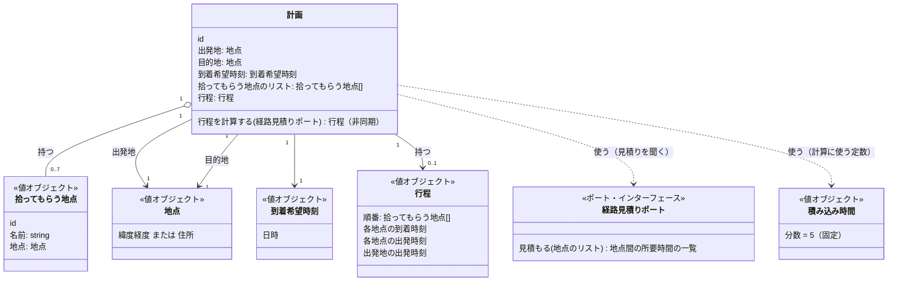

# 02. どう動くか

**この文書は抽出物。** 本来は `features/`・`api/src/domain/`・ADR から抽出するが、
**まだコードが無いので、今回だけ先に手で書く。** コードができたら、そこから作り直す。

7つの機能要件([01-what.md](01-what.md))を見越して、「計画」集約の値オブジェクトと
不変条件を決めた。

## クラス図



実線の矢印は計画が直接持つもの、点線の矢印は計画が使うだけで持たないもの(外部の口)。
「計画」以外に集約は無い。「地点」「到着希望時刻」などは、すべて計画の中の値オブジェクト。

## 集約:計画(Plan)

```
計画 {
  id
  出発地: 地点
  目的地: 地点
  到着希望時刻: 時刻
  拾ってもらう地点のリスト: 拾ってもらう地点[]
  行程: 行程 | まだ無い    // 計算結果のキャッシュ
}
```

- 集約の外から直接いじれるのは `id` 経由だけ。拾ってもらう地点の追加・変更・取消は、
  必ず計画を通して行う([event-storming/process-level.md](../../event-storming/process-level.md) のコマンドはすべて計画に対する操作)。
- **「拾ってもらう地点」に、同乗者を表す別の集約や型は作らない。** ログインが無く、
  共有リンクを開いて自分の地点を入れるだけなので、システムは「誰が追加したか」を
  追跡する必要が無い。地点そのものが、同乗者1人ぶんの申告を表す。

## 値オブジェクト

| 値オブジェクト | 中身 | 等しさの基準 |
|---|---|---|
| **地点**(Location) | 緯度経度、または住所の文字列 | 値が同じなら同じ地点 |
| **拾ってもらう地点**(PickupPoint) | id + 名前 + 地点 | id が同じなら同じもの。地点(値)が同じでも id が違えば別 |
| **到着希望時刻**(DesiredArrivalTime) | 日時 | 値が同じなら同じ |
| **積み込み時間**(BoardingDuration) | 分数。**v1 では常に5分の定数** | — |
| **行程**(Itinerary) | 拾ってもらう地点を回る順番+各地点の到着・出発時刻+出発地の出発時刻 | 計画ごとに1つ |

`拾ってもらう地点` だけ id を持たせた。変更・取消のコマンドが「どの地点か」を
指し示す必要があるため(値だけだと、同じ住所の地点が2つあるとき区別できない)。

## 不変条件(案)

このコマンドの集まりから見えてきた、常に成り立たせたいこと。

- **拾ってもらう地点は、出発地・目的地とは別の地点である。**
  (出発地や目的地と同じ場所を、拾ってもらう地点として登録する意味が無い)
- **行程は、常に今の出発地・目的地・拾ってもらう地点のリストと整合している。**
  地点が変わったら、古い行程のままにしない(process-level.md のポリシーが保証する)
- **拾ってもらう地点が0個でも、計画は成立する**(`features/plan.feature` のシナリオ1)

## まだ決まっていない(Hotspot)

- **同じ地点(同じ住所)を2回登録できるか。** 例えば2人の同乗者が同じ最寄り駅を
  指定した場合、別々の拾ってもらう地点として両方成立させるのか、1つにまとめるのか。
- **到着希望時刻は、未来でなければならないか。** 過去の時刻を指定したら計画を
  作れないのか、作れてしまってよいのか。`00-why.md` にも `features/plan.feature` にも
  まだ出てきていない。

この2つは `question` Issue にする。

## 外部接続の口(ポート)

ドメインは Google Maps Routes API を直接知らない。見積りをもらうだけの口を挟む。

```
経路見積りポート {
  2地点間の移動時間を見積もる(地点, 地点): 分（非同期）
}
```

**最初は同期で設計していたが、本物の実装(HTTP 呼び出し)を書く段になって非同期に直した。**
行程を計算する手続き全体も、これに合わせて非同期になる。

- 本物の実装(`infra/google-maps-route-estimator.ts`)は、Google Maps Routes API を呼ぶ。
  同じ区間を何度も聞かないよう、呼び出し結果をキャッシュする(全部の並び順を試すと、
  同じ区間が何度も出てくるため)。
- `GOOGLE_MAPS_API_KEY` が無いときは、仮の見積り(`infra/stub-route-estimator.ts`、
  どの区間も15分)にフォールバックする。ローカルでキー無しでも動く。
- テストでは、この口を偽物に差し替えて、Google を呼ばずに `features/plan.feature` の
  数字(10分・30分、など)をそのまま確認できるようにする(`docs/README.md` の 8・10)。

## 「行程を計算する」の仕様(擬似コード)

非同期(経路見積りポートが非同期のため)。

```
計画.行程を計算する(経路見積りポート):  // 非同期
  候補 = 拾ってもらう地点のリストの、すべての並び順
  各候補について、出発地 → 候補の順番で回って → 目的地、という経路の
    合計時間(移動時間の合計 + 積み込み時間 × 地点の数)を、経路見積りポートで求める
  合計時間が一番短い候補を選ぶ
  目的地への到着希望時刻から、選んだ候補の合計時間を引いて、出発地の出発時刻を決める
  その出発時刻から、各地点の到着・出発時刻を順番に積み上げる
  行程として返す
```

拾ってもらう地点は v1 で最大7人程度(`01-what.md`)なので、全部の並び順を試しても
現実的な数(7個なら5040通り)に収まる。もっと増えたときの工夫は、そのとき考える。

## 次にやること

- Hotspot 2件を `question` Issue にする
- 足場(Node.js・TypeScript・テストランナーの選定)を ADR にする
- `plan.feature` の3シナリオを、ここで決めた型を使って TDD で実装する(縦切り1本目)
