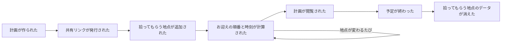

# Big Picture

何が起きるかを時系列に全部出す。粒度や順番の正しさより、**漏れなく出すこと**を優先する。
進め方は [docs/README.md](../docs/README.md) の 4。

## ドメインイベント（時系列）

付箋の色の代わりに、表の列で区別する。すべて過去形。

| # | ドメインイベント | 誰が起こす | 備考 |
|---|---|---|---|
| 1 | 計画が作られた | 運転者 | 出発地・目的地・到着希望時刻を入れた時点 |
| 2 | 共有リンクが発行された | （計画が作られた結果、システムが） | 1と同時かもしれない。Design Level で見る |
| 3 | 拾ってもらう地点が追加された | 同乗者 | リンクを開いて地点を入れる |
| 4 | お迎えの順番と時刻が計算された | （システムが） | 初回の計算。2 や 3 のあとに起きる |
| 5 | 拾ってもらう地点が変更された | 同乗者 | 住所を直す |
| 6 | 拾ってもらう地点が取り消された | 同乗者 | 乗れなくなった |
| 7 | 出発地が変更された | 運転者 | |
| 8 | 目的地が変更された | 運転者 | |
| 9 | お迎えの順番と時刻が再計算された | （システムが） | 3・5・6・7・8 のどれかのあとに起きる |
| 10 | 計画が閲覧された | 運転者・同乗者 | 当日、リンクを開いて最新を見る |
| 11 | 予定が終わった | （時間経過、または運転者） | **いつ起きるか未確定（Hotspot）** |
| 12 | 拾ってもらう地点のデータが消えた | （システムが） | 11 のあと。個人情報を持ち続けない（非機能要件） |

## 全体の流れ（図）

## Hotspot（疑問・揉めごと）

Example Mapping の「疑問」と同じ。消さず、ここに残す。答えが出ないものは `question` Issue にする。

- **「予定が終わった」(#11) の具体的なタイミングは？** 到着希望時刻を過ぎたらすぐか、
  その日の終わりか、数日後か。→ `00-why.md` から持ち越し。
- **共有リンク(#2)は、誰でも地点を追加・変更できるのか？** 知らない人に書き換えられない
  ようにする必要はあるか。→ `00-why.md` から持ち越し。
- **「計画が閲覧された」(#10) は、ドメインイベントとして記録する価値があるか？**
  状態を変えないので、記録してもログ以上の意味が無いかもしれない。
- **#4（初回の計算）と #9（再計算）は、同じ1つのイベントとして扱ってよいか？**
  「お迎えの順番と時刻が計算された」という1種類のイベントが、何度も起きると考えれば
  区別しなくてよいかもしれない。→ Process Level で決める。

## 次にやること（Process Level）

ここにコマンド・アクター・ポリシー・読み取りモデル・外部システムを足し、
イベントの間を繋ぐ。別ファイル（`process-level.md`）で続ける。
