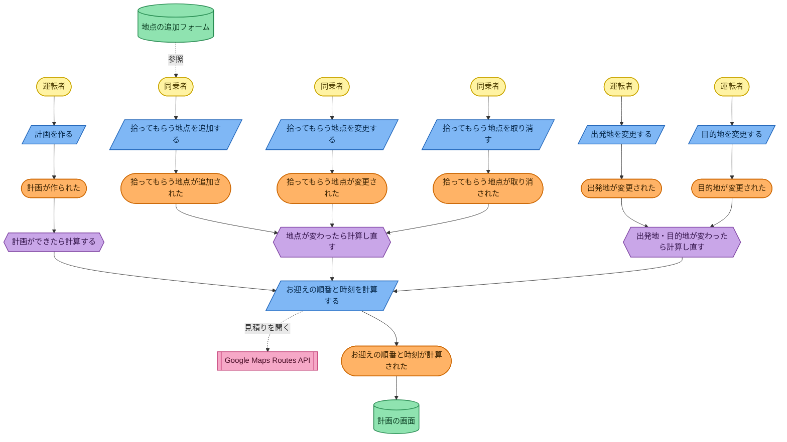

# Process Level

[big-picture.md](big-picture.md) のイベントに、コマンド・アクター・ポリシー・読み取りモデル・
外部システムを足す。進め方は [docs/README.md](../docs/README.md) の 4。

Big Picture の #4 と #9（計算・再計算）は、同じ1種類のイベント「**お迎えの順番と時刻が
計算された**」として扱うことにした。何度も起きてよい。#10（計画が閲覧された）は、状態を
変えないのでドメインイベントとして記録しない。読み取りモデルとして扱う。

## 図1：計画を作る・地点や出発地/目的地を変える（Big Picture の詳細版）

Big Picture の時系列に、コマンド・アクター・ポリシー・外部システム・読み取りモデルを足した。
きっかけは6種類あるが、すべて同じポリシーの輪に集まって、同じ計算コマンドに合流する。

黄(アクター) が青(コマンド) を実行し、橙(イベント) が起きる。それが紫(ポリシー) の
きっかけになり、青(コマンド、ピンクの外部システムに見積りを聞く) を実行し、また橙(イベント)
が起きて、緑(読み取りモデル) に反映される。**「計画を作る」〜「お迎えの順番と時刻が計算された」
までが、Design Level で見つけた集約「計画」の中。**（運転者・同乗者・外部システム・読み取りモデルは外側）

## 図2：予定が終わる（別の図に分けた）

図1はすべて「運転者・同乗者の操作」がきっかけだった。こちらは**時間の経過**がきっかけで、
性質が違うので図を分けた。

```mermaid
flowchart TD
    evEnd([予定が終わった]):::event
    polEnd{{予定が終わったら地点データを消す}}:::policy
    cmdDelete[/拾ってもらう地点のデータを消す/]:::command
    evDeleted([拾ってもらう地点のデータが消えた]):::event

    evEnd --> polEnd --> cmdDelete --> evDeleted

    classDef event fill:#FFB366,stroke:#CC6600,color:#3A2200,stroke-width:1.5px;
    classDef policy fill:#C9A6E8,stroke:#7B3FA0,color:#2E0F45,stroke-width:1.5px;
    classDef command fill:#7FB7F5,stroke:#1E63B8,color:#082a4d,stroke-width:1.5px;
    class evEnd,evDeleted event;
    class polEnd policy;
    class cmdDelete command;
```

「予定が終わった」をいつ起こすかは、まだ決まっていない（#8）。
決まるまでは、図2はこの形のまま保留にする。

## コマンド → ドメインイベント

| コマンド（青） | 実行するアクター | 結果のドメインイベント（橙） |
|---|---|---|
| 計画を作る | 運転者 | 計画が作られた |
| 拾ってもらう地点を追加する | 同乗者 | 拾ってもらう地点が追加された |
| 拾ってもらう地点を変更する | 同乗者 | 拾ってもらう地点が変更された |
| 拾ってもらう地点を取り消す | 同乗者 | 拾ってもらう地点が取り消された |
| 出発地を変更する | 運転者 | 出発地が変更された |
| 目的地を変更する | 運転者 | 目的地が変更された |

## ポリシー（紫） 「〜したら、〜する」

| ポリシー | きっかけのイベント | 実行するコマンド |
|---|---|---|
| 計画ができたら、お迎えの順番と時刻を計算する | 計画が作られた | お迎えの順番と時刻を計算する |
| 拾ってもらう地点が変わったら、お迎えの順番と時刻を計算し直す | 拾ってもらう地点が追加された／変更された／取り消された | お迎えの順番と時刻を計算する |
| 出発地・目的地が変わったら、お迎えの順番と時刻を計算し直す | 出発地が変更された／目的地が変更された | お迎えの順番と時刻を計算する |
| 予定が終わったら、拾ってもらう地点のデータを消す | 予定が終わった | 拾ってもらう地点のデータを消す |

**「お迎えの順番と時刻を計算する」は、コマンドでありドメインイベントでもある。**
システム自身が実行するので、Design Level では集約の中の手続きとして扱う。

## 外部システム（ピンク）

| 外部システム | 何に使うか |
|---|---|
| Google Maps Routes API | 地点間の移動時間を見積もり、お迎えの順番と時刻を計算するのに使う |

## 読み取りモデル（緑）

| 読み取りモデル | 誰が見るか | 何を見せるか |
|---|---|---|
| 計画の画面 | 運転者・同乗者 | 今のお迎えの順番・各地点の時刻・出発時刻 |
| 地点の追加フォーム | 同乗者 | 自分の拾ってもらう地点を入れる画面 |

## アクター（黄・小）

- **運転者**: 計画を作る。出発地・目的地を変更する。
- **同乗者**: 拾ってもらう地点を追加・変更・取り消す。
- （システム）: 計算のポリシーと、データを消すポリシーを実行する。

## Design Level（集約の候補）

**「計画」が集約になる。** コマンドを受けてイベントを出す、ルールの塊がここに集まっている。

- 集約: **計画**（出発地・目的地・到着希望時刻・拾ってもらう地点のリスト・お迎えの順番・各地点の時刻）
- 集約の外から直接いじれるのは、計画の ID 経由だけ。拾ってもらう地点は、計画を通してしか追加・変更できない。
- 「お迎えの順番と時刻を計算する」は、計画という集約の中の手続き（ドメインサービスに近い）。
  Google Maps Routes API は、計画の外（ポート越し）から見積りをもらうだけ。

DDD の段（Day で言えば次のあたり）で、不変条件（同じ地点を2回登録しない、など）と
値オブジェクト（地点、時刻、積み込み時間）を具体化する。
